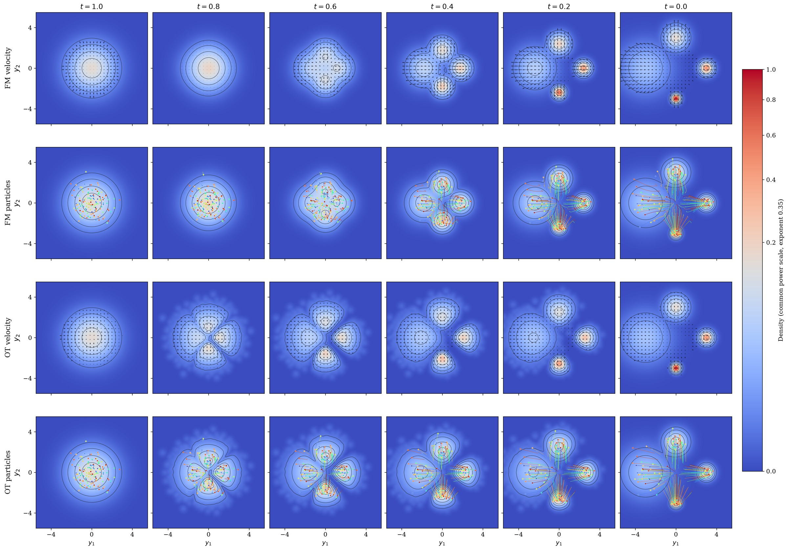

# Flow Matching and Optimal Transport: An Illustrated Introduction to Wasserstein–Otto Geometry

**Pierre Guilbert · 2026 · Pedagogical manuscript**

An illustrated introduction to the velocity fields of Flow Matching and their relation to Wasserstein–Otto geometry. We derive the density of the independent linear interpolation, connect it to the continuity equation, and distinguish the minimum-energy velocity of a prescribed path from a geodesic between its endpoints.

For an isotropic Gaussian initial law, the population Flow Matching velocity is already the minimum-energy representative of the density variation. The path is generally not a Wasserstein geodesic.

[Read the manuscript (PDF)](manuscript.pdf) · [Website source](docs/index.html) · [Figure gallery source](docs/gallery.html) · [BibTeX](citation.bib)



## Contents

- `manuscript.pdf`: the reference manuscript (under 5 MB).
- `python_scripts/`: the eight figure and animation scripts.
- `figures/`: original PNG/PDF figures, MP4 videos, saved numerical data and diagnostics.
- `docs/`: self-contained GitHub Pages website, HTML paper, figure gallery and videos.
- `CITATION.cff` and `citation.bib`: citation metadata.

The LaTeX source and private working notes are not distributed.

## Reproduce the illustrations

```bash
python -m venv .venv
source .venv/bin/activate
python -m pip install -r requirements.txt
python python_scripts/plot_contracted_convolution.py
python python_scripts/plot_convolution_velocity.py
python python_scripts/animate_generative_flow.py --mode panels
```

Each plotting script saves PNG and PDF files in `figures/`. To regenerate the videos, install FFmpeg and run `python python_scripts/animate_generative_flow.py`.

| Script | Illustration |
| --- | --- |
| `reynolds_transport_probability.py` | Preservation of mass and Reynolds transport |
| `plot_contracted_convolution.py` | Contracted convolution along the linear interpolation |
| `plot_convolution_velocity.py` | Density and marginal velocity |
| `animate_generative_flow.py` | Numerical integration, particle panels and two videos |
| `compare_fm_geodesic.py` | Flow Matching and an empirical optimal transport geodesic |
| `compare_fm_wo_velocity.py` | Flow Matching and its WO gradient representative |
| `particle_transport_examples.py` | Gaussian, Laplace, mixture and anisotropic examples |
| `compare_initial_laws.py` | Gaussian, Laplace, disk and square initial laws |

The empirical optimal transport comparison uses 16,384 endpoint samples. Computing its assignment from scratch can take considerable time and several GB of memory; the saved coupling is included. The plotted geodesic is a numerical approximation. See each script and the JSON diagnostics for the numerical choices. Disk and square initial laws are mollified in the numerical illustrations.

## Website

See [WEBSITE.md](WEBSITE.md) to preview or publish with GitHub Pages. The website includes the full manuscript in HTML, all nine manuscript figures with their captions and downloadable PDFs, and both animations.

## Citation

Guilbert, P. (2026). FLOW MATCHING AND OPTIMAL TRANSPORT: AN ILLUSTRATED INTRODUCTION TO WASSERSTEIN–OTTO GEOMETRY. Zenodo. https://doi.org/10.5281/zenodo.24084198

[Zenodo record](https://zenodo.org/records/24084198) · [DOI](https://doi.org/10.5281/zenodo.24084198)

```bibtex
@unpublished{guilbert2026flowmatching,
  author = {Guilbert, Pierre},
  title = {Flow Matching and Optimal Transport: An Illustrated Introduction to Wasserstein--Otto Geometry},
  year = {2026},
  publisher = {Zenodo},
  doi = {10.5281/zenodo.24084198},
  url = {https://doi.org/10.5281/zenodo.24084198},
  note = {Pedagogical manuscript}
}
```

## Author and related notes

[Pierre Guilbert](https://orcid.org/0009-0002-1582-4435) · [Contact](mailto:spguilbert@gmail.com)

- [Fisher–Rao and Wasserstein–Otto: a comparative atlas](https://github.com/PierreGuilbertF/fisher-rao-wasserstein-atlas)
- [Pullback Fisher–Rao atlas](https://github.com/PierreGuilbertF/pullback-fisher-rao-atlas)
